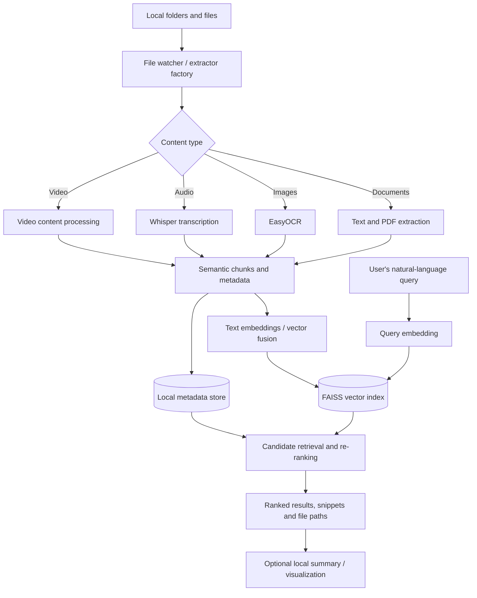

# ✨ Lumina

### Deep Search Across All Extensions

**An offline, privacy-first, multimodal semantic search system for local files.**

*Final Year Project · BS Computer Science · FAST–NUCES, Peshawar · 2025–2026*

  

---

## Overview

**Lumina** is a local-first desktop search assistant designed to help people find meaningful information scattered across heterogeneous files. Rather than relying only on filenames or exact keyword matches, Lumina extracts and indexes content so a natural-language query can retrieve contextually relevant results.

The system brings together document extraction, optical character recognition (OCR), audio transcription, semantic embeddings, and vector search. Its core goal is to keep indexing and retrieval **on the user's computer**, without needing to upload private documents to an external search service.

> **About this repository:** This is the **public academic documentation repository**, not a public software distribution. The implementation lives in a separate private repository. Links to the academic poster and proposal work after their original files are added to `docs/`.

## Why Lumina?

| Challenge | Lumina's approach |
|---|---|
| Information spread across PDFs, documents, images and recordings | A single file-ingestion and search workflow |
| Keyword search misses semantically related passages | Embedding-based semantic retrieval using FAISS |
| Scanned images and speech are not directly searchable | OCR and offline speech-to-text extraction |
| Sensitive local content should not be uploaded for search | Local-first processing and storage |
| Large collections are difficult to browse manually | Ranked search cards with contextual snippets and file locations |

## Main capabilities

- **Multimodal indexing:** handles document/text, image, audio, and video-oriented workflows described in the thesis; support varies by file extension and extractor.
- **Semantic search:** embeds natural-language queries and retrieves relevant content with FAISS.
- **Image OCR:** extracts text from images using EasyOCR.
- **Audio transcription:** uses Whisper to make recorded speech searchable.
- **Context-preserving chunks:** splits extracted material into searchable passages while preserving overlap.
- **Custom result re-ranking:** combines similarity with file-type quality and rank-position signals.
- **File and folder management:** indexes watched directories and exposes indexing progress.
- **Search results and analytics:** provides snippets or timestamps, paths to original files, and indexing statistics.
- **Optional local AI features:** thesis documentation describes summaries, smart collections, and keyword heatmaps, with Ollama as an optional local LLM service.

## How the system works

This is a **high-level view** synthesized from the thesis, not a claim that every supported extension uses an identical extraction path.

## Technical overview

The thesis's final implementation chapters describe the following components:

| Layer | Technology / role |
|---|---|
| Language and dependency management | Python 3.10+; Poetry |
| API/backend | FastAPI with local REST endpoints |
| Desktop / user interface | PyWebView, HTML5, CSS3, Vanilla JavaScript |
| Vector search | FAISS |
| Semantic embeddings | SentenceTransformers `all-MiniLM-L6-v2` |
| Image processing | EasyOCR; CLIP is also identified in the technical stack |
| Speech processing | OpenAI Whisper |
| Optional local AI summaries | Ollama with `qwen2.5:0.5b` |
| Persistence | Local vector index plus metadata storage |

The thesis documents an API on `127.0.0.1:8000`, local application storage under `~/.lumina`, and an optional Ollama service at `http://localhost:11434`. Earlier design iterations mention Electron; the table above follows the **later implementation sections** of the report.

## Project documents

| Document | Description |
|---|---|
| 📘 [Final thesis](docs/Lumina-Thesis.pdf) | Architecture, implementation, experiments, testing, user manual, conclusions |
| 🖼️ [Project poster (PDF)](docs/Lumina-Poster.pdf) | Final-year project poster **(add original PDF before publishing)** |
| 🖼️ [Project poster (PNG)](docs/Lumina-Poster.png) | Poster image for convenient preview **(add original PNG before publishing)** |
| 📄 [FYP proposal](docs/Lumina-Proposal.pdf) | Initial project proposal **(add original PDF before publishing)** |

## Evaluation described in the thesis

The final report **reports** approximately **260 automated unit/integration tests**, a **95% test pass rate**, and **sub-100 ms vector lookup/metadata binding** in its stated test scenario. These figures come from the thesis's own evaluation and are not independently reproduced by this public documentation repository.

The thesis also describes testing for multimodal file indexing, chunk-overlap behavior, search re-ranking, FAISS index persistence, malformed-file handling, and retrieval latency.

## Current limitations and future direction

The thesis identifies hardware-dependent performance, incomplete support for some extensions, and the absence of personalized ranking. Proposed future enhancements include encrypted multi-device sync, AI-assisted file organization, voice operation, and a plugin ecosystem.

## Source code availability

**The Lumina application source code is intentionally not public.** It is maintained separately in a **private GitHub repository**. This public repository contains academic material only: the thesis, poster, and proposal. Installation and execution instructions in the thesis are intended for those who have been given access to the source.

**Do not upload** the `Lumina/` application folder, `.env` files, models, indexes, personal data, or secrets to this public repository.

## Academic credits

**Project team** (as listed on the thesis cover):
- Sahil Anwar
- Shayan Rasool
- Azeem Ahmad

**Supervisor:** Dr. Ali Sayyed  
**Department:** Computer Science  
**Institution:** National University of Computer and Emerging Sciences (FAST–NUCES), Peshawar, Pakistan

## Citation

If you reference the project in academic work, please cite the final thesis:

> Anwar, S., Rasool, S., and Ahmad, A. *Lumina: Deep Search Across All Extensions.* Final Year Project thesis, Department of Computer Science, FAST–NUCES, Peshawar, 2025–2026.

*The cover page and declaration/approval pages use different surnames for one team member. Please verify the preferred official name before sharing this citation publicly.*

## Licensing / reuse

This repository is provided for academic viewing and reference. **No software license is granted for the private application code.** The thesis/poster/proposal should not be assumed to be freely redistributable beyond permissions held by their authors/institution. Contact the project team for reuse inquiries.
